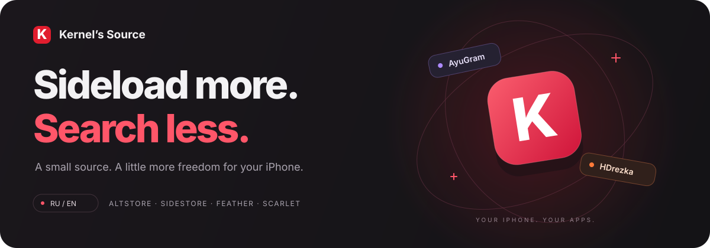
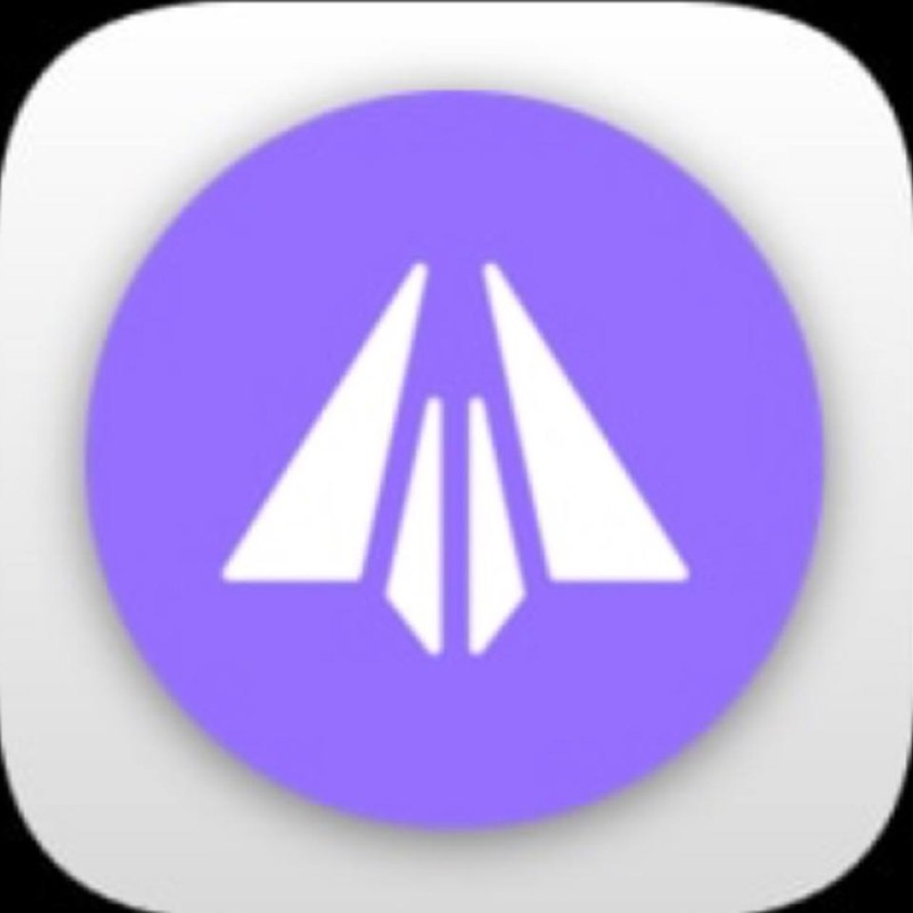

<div align="center">

<a href="https://rep.kerneldev.qzz.io">
  
</a>

<br>

**Небольшой репозиторий приложений. Чуть больше свободы для вашего iPhone.**

[Открыть сайт](https://rep.kerneldev.qzz.io) · [Источник JSON](https://rep.kerneldev.qzz.io/source.json) · [Релизы](https://github.com/kkerneldev/repkernel/releases) · [Сообщить о проблеме](https://github.com/kkerneldev/repkernel/issues)

[](https://github.com/kkerneldev/repkernel/actions/workflows/validate-source.yml)
[](https://github.com/kkerneldev/repkernel/actions/workflows/sync-release.yml)
[](LICENSE)

</div>

<br>

## Приложения

<table>
<tr>
<td width="50%" valign="top">
<a href="https://rep.kerneldev.qzz.io/app.html?id=org.ayugram.app"></a>
<h3>AyuGram <sup>Beta</sup></h3>
<p>Клиент Telegram с расширенными функциями и гибкими настройками.</p>
<a href="https://rep.kerneldev.qzz.io/app.html?id=org.ayugram.app">Посмотреть приложение →</a>
</td>
<td width="50%" valign="top">
<a href="https://rep.kerneldev.qzz.io/app.html?id=me.keet.HDRezka"></a>
<h3>HDrezka</h3>
<p>Фильмы и сериалы: удобный каталог и быстрый поиск.</p>
<a href="https://rep.kerneldev.qzz.io/app.html?id=me.keet.HDRezka">Посмотреть приложение →</a>
</td>
</tr>
</table>

## Один источник — все приложения

Откройте [сайт](https://rep.kerneldev.qzz.io), выберите свой установщик и нажмите **«Добавить»**. Или скопируйте адрес в раздел источников вашего клиента:

```text
https://rep.kerneldev.qzz.io/source.json
```

**AltStore Classic · SideStore · Feather · Scarlet**<br>
Для прямого скачивания IPA выберите на сайте **Direct links / TrollStore**.

Установщик должен быть установлен заранее. Требования iOS и доступная версия указаны в карточке каждого приложения.

## Внутри сайта

| | Что есть |
| :--- | :--- |
| **Своя витрина** | Крупные карточки, скриншоты и цветовые акценты приложений. |
| **RU / EN** | Перевод интерфейса и общий выбор языка для главной и страниц приложений. |
| **Светлая и тёмная темы** | Системная тема по умолчанию и ручное переключение. |
| **Офлайн-каталог** | Сохранённые страницы и данные доступны после первого посещения. |
| **Живые счётчики** | Скачивания конкретного IPA из GitHub Releases с обновлением раз в две минуты. |
| **Обновления** | Автоматическая синхронизация версий и карточки новостей. |

<details>
<summary><b>Как работает офлайн-режим</b></summary>

После сообщения **«Страницы и каталог доступны офлайн»** можно открывать главную и страницы приложений без подключения, включая страницы приложений, которые ещё не посещали отдельно.

- Каталог сначала запрашивается из сети. При ошибке или ожидании дольше 4,5 секунды используется последняя корректная копия.
- После восстановления подключения данные обновляются автоматически.
- Индикатор показывает время сохранения каталога, а не дату выпуска приложения.
- Изображения сохраняются по мере просмотра, до 60 штук. Непросмотренные скриншоты могут быть недоступны.
- IPA, запросы к API релизов и ссылки установщиков не кэшируются.

Первое посещение требует интернета. Service Worker работает на HTTPS или localhost; браузер может удалить кэш при нехватке места.

</details>

<details>
<summary><b>Откуда берётся число скачиваний</b></summary>

Счётчик читает поле `download_count` у файла GitHub Releases. Релиз и имя IPA определяются по `downloadURL` приложения: одноимённые файлы из других релизов не суммируются.

Числа обновляются каждые две минуты, пока вкладка видима и есть подключение. При возвращении на вкладку проверка возобновляется с учётом интервала. При ошибках остаётся последнее известное значение; при достижении лимита GitHub запросы приостанавливаются.

Это скачивания файла, а не установки или уникальные пользователи. Удаление и повторная загрузка файла меняют его счётчик на GitHub.

</details>

## Разработка

Статический сайт на **HTML, CSS и JavaScript**. Без сборки фронтенда.

```sh
python -m http.server 8000
```

Откройте **http://localhost:8000**. Для проверки офлайн-режима дождитесь сохранения каталога, затем отключите сеть.

### Проверка каталога

Python 3.12+, без дополнительных зависимостей:

```sh
python scripts/validate_source.py
```

Проверяются обязательные поля, дубликаты приложений и пар версий/сборок, URL, даты, размеры, формат SHA-256 и ссылки на избранные приложения. Проверка запускается также в GitHub Actions и перед коммитом результатов синхронизации.

### Синхронизация релизов

```sh
python -m pip install pillow
python scripts/sync_release.py --dry-run
```

Для записи изменений запустите скрипт без `--dry-run`. Он читает IPA из релизов, обновляет метаданные и SHA-256, а для новых версий создаёт новости и изображения.

GitHub Actions запускает синхронизацию при публикации или редактировании релиза, по расписанию раз в шесть часов и вручную. Параметр `force_news` позволяет создать новости для уже опубликованных текущих версий.

<details>
<summary><b>Переменные синхронизации и переводы</b></summary>

| Параметр | Назначение |
| :--- | :--- |
| `GITHUB_REPOSITORY` | Репозиторий релизов; по умолчанию `kkerneldev/repkernel`. |
| `GITHUB_TOKEN` | Необязательный токен для запросов к GitHub API. |
| `NEWS_LANG` | Язык новостей: `ru` по умолчанию или `en`. |
| `SITE_URL` | Адрес сайта для ссылок на изображения новостей. |
| `NEWS_NOTIFY` | `true` включает уведомления новостей в AltStore. |
| `FORCE_NEWS` | `true` создаёт недостающие новости текущих версий. |

Заметки можно задать в `notes/<bundleId>.txt`. В остальных случаях используется текст релиза, если он содержит не более одного IPA.

Страница приложения поддерживает словари `localizedSubtitles` и `localizedDescriptions` с ключами `ru` и `en`.

После изменения офлайн-оболочки увеличьте `VERSION` в [sw.js](sw.js). Обновлённый Service Worker активируется после закрытия старых вкладок сайта.

</details>

### Тесты

Проверка логики счётчиков требует Node.js:

```sh
node tests/downloads.cjs
```

Браузерные проверки требуют установленного пакета Playwright и Chromium:

```sh
node tests/offline.cjs
node tests/showcase.cjs
```

Для собственного браузера задайте `BROWSER_EXECUTABLE` — путь к исполняемому файлу Chromium или Edge.

### Структура

```text
index.html              Главная и каталог
app.html                Страница приложения
source.json             Источник для установщиков
news.json               Лента новостей сайта
sw.js / offline.html    Офлайн-кэш и страница-заглушка
assets/                 Стили, шрифты, иконки и карточки новостей
screenshots/            Скриншоты приложений
scripts/                Синхронизация, проверка и генерация ресурсов
tests/                  Проверки логики и браузерных сценариев
.github/workflows/      Автоматизация GitHub Actions
```

---

<div align="center">

**Kernel’s Source** · [Сайт](https://rep.kerneldev.qzz.io) · [GitHub Releases](https://github.com/kkerneldev/repkernel/releases)

<sub>Код репозитория — <a href="LICENSE">MIT</a>. Сторонние приложения и ресурсы принадлежат их правообладателям.<br>Проект не связан с AltStore, SideStore, Feather или Scarlet.</sub>

</div>
